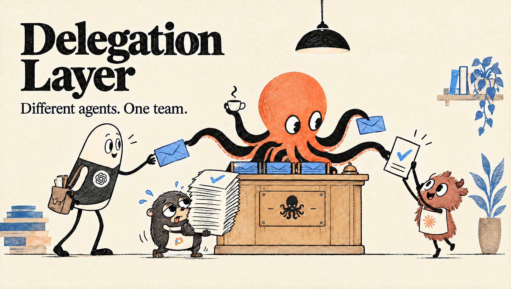

# Delegation Layer

Delegate manages bounded tasks run by the agent CLIs you already use, locally
or on a prepared remote machine over SSH: delegation, tracking, budgets,
cancellation, and retrieving results with evidence. Local tasks also support
exact-session continuation.

**[Install](https://github.com/hishamkaram/delegation-layer/blob/main/docs/installation.md)**
· [Example](#ask-naturally)
· [Providers](https://github.com/hishamkaram/delegation-layer/blob/main/docs/providers.md)
· [Remote tasks](docs/remote-delegation.md)
· [Terminal workbench](docs/terminal-workbench.md)
· [Teams](https://github.com/hishamkaram/delegation-layer/blob/main/docs/teams.md)
· [Start recurring tasks](docs/getting-started.md#recurring-tasks)
· [Docs](https://github.com/hishamkaram/delegation-layer/blob/main/docs/README.md)

<p align="center">
  <a href="https://github.com/hishamkaram/delegation-layer/blob/main/docs/installation.md"></a>
</p>

## What it provides

| Capability | Benefit | Status | Reference |
| --- | --- | --- | --- |
| Terminal workbench | Browse Tasks, Teams, Schedules and System; review explicit actions before submitting them. | Available | [TUI guide](docs/terminal-workbench.md) |
| Supervised agent tasks | Track one bounded turn through a provider-neutral interface. | Available | [Task commands](skills/agent-integration/references/command-reference.md) |
| Budgets and cancellation | Bound execution time, opt into output-silence limits and request an explicit stop. | Available | [Result handling](skills/agent-integration/references/result-handling.md) |
| Durable results | Passively wait for several tasks and collect validated evidence after each turn ends. | Available | [Results](skills/agent-integration/references/result-handling.md) |
| Exact-session continuation | Follow up in the recorded provider conversation. | Available | [Continuation](skills/agent-integration/references/continuation.md) |
| Native clarification | Answer questions and steer supported active turns. | Available | [Interaction](skills/agent-integration/references/interaction.md) |
| Managed Git workspaces | Separate parallel writes and review captured changes before landing them. | Available | [Workspaces](skills/agent-integration/references/workspaces.md) |
| Remote tasks over SSH | Reconnect to the same task, inspect bounded logs, transfer selected files, and explicitly retire retained bytes. | Available | [Remote workflow](docs/remote-delegation.md) |
| Recurring background tasks | Run immutable schedules with health, optional failure hooks and bounded opt-in quota holds. | Available | [Schedule reliability](skills/agent-integration/references/command-reference.md#schedule-reliability) |
| Optional Teams | Save scoped Roles, Members and execution defaults; explicitly choose a Member for direct or scheduled work. | Available | [Teams](docs/teams.md) |

Fresh dispatches and continuations check CPU and memory pressure by default.
Use `--cpu-guard=false` or `--memory-guard=false` for an explicit per-command
opt-out; it does not change running tasks, saved settings or nested tasks. See the
[resource-check contract](skills/agent-integration/references/command-reference.md#dispatch).

Operator-managed gateways can use the additive [guarded local connector
contract](docs/connector-contract.md) for context-pinned admission and recovery.

## Get started

For a standalone installation, use guided setup (Node.js 18 or later):

```sh
npx --yes delegation-layer setup
```

Choose global scope for use across projects. Setup installs a missing CLI bundle,
checks passive readiness, and installs the selected skill and routing integration.
Review any printed PATH, restart and hook-trust steps yourself. It prints a
first-task prompt or example; it does not launch a provider task.

These docs describe current main; published npm and CLI releases can lag.
Setup needs a matching CLI release when installing an absent bundle. See
[installation](docs/installation.md) for availability, the integrated Codex/Claude
plugin route, and advanced installation options.

For a keyboard interface, run `delegate tui` in a terminal. It uses the same
execution root and operation owners as the CLI; browsing starts no task or
scheduler. See the [workbench guide](docs/terminal-workbench.md) for controls,
dated history and safe shutdown.

## Ask naturally

Inside Claude, after installing and trusting the integration, try:

> Ask Codex to review the current changes and return confirmed issues and recommendations.

For reusable task selection, try:

> Register a project review Team with a primary Member using Codex defaults.
> Show its saved configuration, then ask that Member to review the changes,
> read-only, with a 30-minute budget.

[Teams](docs/teams.md) are optional; direct delegation needs no catalog setup.

The lead loads its installed skill, sends a bounded task through Delegate,
tracks it, then collects and evaluates the answer. Your provider keeps its
native account and configuration. Permissions select provider-native behavior;
see [security](https://github.com/hishamkaram/delegation-layer/blob/main/docs/security.md).

Ordinary subagents in the current harness remain available. Ask for a separate
session when you want another instance of that same CLI. Hooks supply a routing
preference; the harness and model still choose tools. See
[agent routing](https://github.com/hishamkaram/delegation-layer/blob/main/docs/agent-routing.md)
for activation and limits.

For a manual CLI task, use the packaged
[read-only example](skills/agent-integration/examples/read-only-task.md).

For another machine, follow the [remote workflow](docs/remote-delegation.md)
to prepare the destination, verify SSH trust and choose a prepared workspace or
explicit file snapshot. The destination owns supervision and outcomes; a lost
connection does not authorize another launch. Remote continuation and offline
recheck are not exposed in the current remote workflow.

Use `schedule health` for occurrence outcomes. `scheduler status` reports host
and installation readiness; a ready host alone does not prove successful runs.

For recurring work, follow the [scheduler walkthrough](docs/getting-started.md#recurring-tasks)
to start `delegate scheduler serve` in your own terminal or tmux pane, even
before saving a definition. Agents and manual commands share the CLI's default
state across projects. The walkthrough covers saving a schedule, inspecting its
first result and stopping or restarting the host.

## Help and contributing

See [troubleshooting](https://github.com/hishamkaram/delegation-layer/blob/main/docs/troubleshooting.md),
[open an issue](https://github.com/hishamkaram/delegation-layer/issues), or read
[contributing](https://github.com/hishamkaram/delegation-layer/blob/main/docs/contributing.md).

## License

[MIT](LICENSE).
