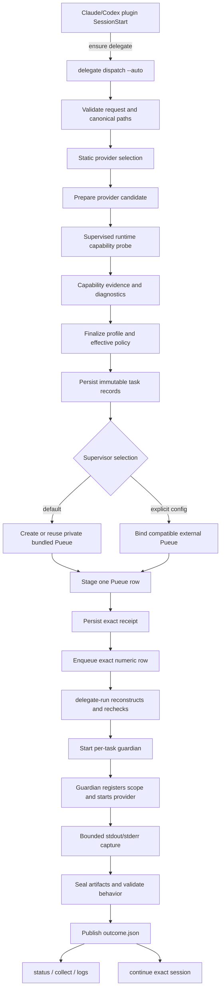

# Architecture

Delegation Layer separates request durability, supervisor control, provider
behavior, and result publication. A provider adapter describes a launch; the
shared core owns when a process may start and what evidence can become a
result.

The maintained Archify views are [system components](../diagrams/components.html)
and [one task lifecycle](../diagrams/lead-interface.html). Their editable
sources are [components.architecture.json](../diagrams/components.architecture.json)
and [lead-interface.sequence.json](../diagrams/lead-interface.sequence.json).

The plugin bootstrap is outside the task lifecycle. It only makes the
provider-neutral control CLI available before the agent can use the skill; the
CLI and its private supervisor still own admission, execution, evidence, and
continuation after dispatch.

## Ownership boundaries

The CLI validates user input, resolves the catalog entry, and persists the
request. Provider preparation constructs an immutable candidate containing the
command, environment, policy, input/output declarations, and identity
observer. It does not start a process.

The inspection worker performs the provider's version and help checks under a
bounded timeout. Its non-secret facts, including a bounded observed version,
are passed to the profile finalizer,
which records the observed version, executable identity, effective policy, and
bounded launch environment in the task metadata. The inspection binding keeps
the same environment for a queued worker, including when a private daemon is
reused for another task. The version is an observation; advertised behavior
and the executable identity decide compatibility. New profiles record native
permission selections without inventorying provider configuration. MCP servers,
hooks, plugins, skills, and authentication are owned by the provider CLI.
Workspace-write asks for unattended native tool execution; it does not add a
provider-independent sandbox. Historical tasks retain their recorded task and
policy contract; only a fresh provider runtime identity may be refreshed before
launch. Fresh dispatches use the current provider mapping. An ordinary
exact-session continuation reconstructs the predecessor's recorded preparation
contract, including its historical mapping, environment, policy, and predicate,
then adds the successor turn and exact recorded session. OpenCode, Pi, and CCR
all use this path. Interactive continuation is the deliberate exception:
Codex and Claude build the current interactive profile while preserving the
recorded session identity and restoring the predecessor environment needed to
find that session. No continuation modifies predecessor evidence.

Immediately before a provider process may start, the runner performs a fresh
capability inspection and receives a current launch plan. A provider path,
reported version, or executable digest may therefore change after admission
when the current CLI still satisfies the adapter's version/help and declared
runtime contract. The runner keeps the admitted task request, predicate, permission,
workspace, writable roots, policy sources, and declared artifacts fixed; a
change to any of those contracts is rejected before launch.

Pueue owns scheduling and worker-row state. One application lifetime state
machine owns native-lifetime transition policy for both the live guardian and
recovery. Task or inspection storage owns its durable lifetime records. The
execution runner owns provider `Start`, pipes, capture, and `Wait`. The live
guardian retains its native scope handle and lifetime-owner lease through
finalization; only the state machine may dispose a native scope. Every normal install carries the
matching `pueue` and `pueued` executables and creates a private state-rooted
configuration on demand. Release archives keep the pair beside the CLI;
Homebrew installs it in the formula’s private `libexec` directory so it cannot
conflict with another Pueue installation. The CLI resolves either layout
without requiring separately managed Pueue. Commands that need supervisor
control recover that private daemon from the saved binding after a restart. For
the private supervisor, the state-rooted config path, config digests, and
endpoint define durable identity. Executable paths, hashes, resolver details,
and observed versions remain provenance; a live daemon is adopted only after
the resolved Pueue client successfully reads and parses its status through that
private config. Fresh configs use the ordinary state-rooted socket name when it
fits the host's Unix-domain limit and a compact name in the same private
supervisor directory otherwise. Delegate validates that path before publishing
the config. It can atomically repair only its exact legacy over-limit config
when an unfinished bootstrap journal proves ownership and no daemon or
generation record exists. New private bindings use a verified content-addressed
client/daemon pair under the state root. Recovery reuses the saved executable
pair when it is available. A different verified client may inspect a compatible
active endpoint without changing its generation, but it cannot start or publish
its own daemon over a stopped active generation. When the saved active pair is
unavailable, the explicit journaled supervisor migration transfers authority to
the staged pair before that pair may start. A legacy
binding without daemon identity is recovered only through a resolved pair and
the normal private config and endpoint checks. Launch provenance is atomically
recorded after readiness. New private daemon launches inherit the spawning Go
process's available soft file-descriptor limit, within the OS hard limit,
instead of Go restoring a lower pre-runtime limit for that child. This affects
child inheritance in the current short-lived Delegate process; it changes no
limit value or system-wide setting and does not restart an existing daemon. The
daemon also starts in its own Unix session, so a signal to the invoking CLI's
process group cannot terminate the private supervisor.

The completed supervisor identity is the sole active-generation record. The
state-root executable-pair record is verified successor inventory until fresh
bootstrap or explicit migration publishes it as active. The ordinary-scheduling
receipt proves default-group policy and the staged add/enqueue command surface
for the exact active generation; it never selects executables. This lets an
install upgrade stage a compatible pair while
ordinary admission keeps using the published daemon and its queued work. A
launch-path or digest change is provenance drift only and does not rewrite the
active identity while that daemon is alive. Ordinary controls share a lease on the supervisor generation, allowing
independent tasks to proceed concurrently. Startup and migration take the
exclusive form of that same lock. An unfinished control command retains its
lease until its process is reaped. Healthy probes reuse a published client
version only after verifying the same executable bytes and resolution; they
still observe the live endpoint. Once Delegate has published both the generation
identity and its exact-generation ordinary-scheduling receipt, warm admission
checks those records and connects to the private Unix socket under the shared
lease without launching a Pueue client process. A missing or refused endpoint,
a changed binding, or a stale receipt enters one elected exclusive path, which
uses Pueue's group protocol before it repairs policy or restarts anything.
Changed bindings use normal version discovery. The staged command surface is
probed only while repairing that exact-generation receipt; warm submissions
and staged recovery consume the recorded capability without repeating help
commands.
Pueue's terminal callback triggers maintenance after a row reaches `Done`;
dispatch records the admission verdict and does not wait for cleanup.
Every current ordinary and inspection submission installs a callback ticket
before enqueue. Its callback publishes an ID-scoped candidate event before it
requests maintenance. When the callback is delayed, exact admission observation
revalidates an ended inspection row under queue identity and publishes the same
event. That accepted observation starts an independent `delegate-run`
maintenance process, so cleanup survives the observing CLI without extending
admission.

The event directory is the durable candidate inbox; it remains recoverable even
if the generation-journal write or process handoff fails. The per-root journal
owns requested, attempted, successful, and full-recovery watermarks. The
election lock alone identifies the live owner. A callback that loses the
nonblocking election returns immediately. The winner waits for a short bounded
quiet interval, captures the latest generation, and handles the completion
burst in one pass. It rechecks the durable journal after releasing ownership,
so a wake published during final handoff is either drained by that owner or
wins the next election. Requests arriving during a pass remain above the
attempted watermark and receive the same quiet interval before a later pass.
A control command that outlives its finite observation window remains owned
through natural completion and does not consume the generation early. Before
retrying, that owner observes release of the retained election lock, so it
cannot misclassify itself as a competing owner and strand the durable wake. A
released interrupted pass is recoverable; a finished failed attempt waits for a
later trigger instead of looping. Validated root activation also resumes retained
inbox or journal work.
Under the event lock, maintenance also removes exact-shaped temporary publisher
files left by an interrupted create-once write. Those files never carry event
authority. Committed numeric filenames and payloads still receive strict
validation, and unrelated entries remain errors.

Normal passes stream one queue snapshot and expose only event-backed numeric
IDs to Delegate's cleanup policy, for both ordinary and inspection rows. Every
same-label row remains visible so ambiguity cannot be hidden. A conservative
full-recovery wake is used when candidate publication fails or a historical row
has no ticket; it additionally exposes ordinary managed rows while inspection
rows still require candidate events. Durable task and inspection journals
remain the sole authority for every removal. A later callback or accepted
terminal observation wakes a retry for rows retained by an earlier failed pass.

A queue writer publishes intent under its dedicated owner lock before waiting
for exclusive queue identity. New readers check that intent before and while
crossing the short gate, so a continuous submission stream cannot overtake the
writer. An abandoned intent is cleared only after exclusive acquisition proves
its writer is gone. Application authorization runs without queue identity;
maintenance then takes a fresh same-scope snapshot under the exclusive identity
mutation, verifies every authorized terminal row is unchanged, removes those
exact IDs, and retires callback state after successful removal. Failed removal
keeps the event for retry. Every new submission resets callback classification
before enqueue while holding queue identity, preventing an old hint from
crossing numeric-ID reuse. Queued inspection stops do the same before their
authorized `remove`. If durable evidence is terminal while the row still
reports running, maintenance releases queue identity during settlement and
reacquires it for a fresh snapshot. The stable callback helper path is
atomically refreshed for compatible implementation upgrades, so an existing
daemon receives current behavior without callback-config drift.
Every supervisor command inherits duplicates of all nested generation, writer,
gate, and identity leases held by its caller. A finite observer timeout or
caller exit therefore cannot release an outer lifecycle lease while the owned
command can still mutate the queue.
Maintenance failures do not change task outcomes. A real logical
config or endpoint migration is explicit and runs under the state-root lock:
it proves the queue is safe, shuts down the old endpoint through its client,
starts the current bundled daemon, and then replaces the launch record. Before
shutdown it creates `.supervisor/migration.json`, then atomically advances its
recorded PID and shutdown phase. Recovery preserves that progress. After shutdown
is recorded, recovery finishes the recorded successor before considering a later
installation. Normal execution and recovery share successor publication and
cleanup; they remove the journal only after identity and recovery alias are
settled. The process starting a daemon owns an asynchronous waiter so exited
children are reaped without blocking startup. An explicit
`--pueue-config` can bind an existing compatible supervisor. `delegate-run`
receives the saved root and task ID plus an internal supervised-launch marker.
Dispatch uses `add --stashed --print-task-id` so the exact row cannot run while
its receipt is being published. It records that numeric receipt against the
immutable task and only then issues `enqueue` for that ID. A receipt-write or
enqueue interruption leaves the same stashed row for exact status recovery; it
never permits an unrecorded runner to start and never authorizes another add.
Once scheduled, a marked runner validates the durable receipt and opens the
saved binding without bootstrapping, migrating, or scanning the queue. Managed
inspection workers use the same staged protocol, including terminal-event
registration before receipt commit and enqueue. Their guardian owns the exact
child `Wait`, completes the shared empty-scope finalization policy, and durably
records both facts before the scope can be disposed or its owner lease released.
Successful exit evidence remains bound to the worker's completed inspection
record. An exact failed exit is terminal unavailable evidence even when the
worker failed before writing that completion. Legacy and custom inspection
workers, missing local evidence, and direct ordinary runner invocations without
the marker retain bounded Pueue reconciliation. This keeps lifecycle control in
dispatch and observation while allowing many workers to finish without
per-completion control-plane fan-out. The runner then
reconstructs the recorded profile and refuses to start if the fresh profile no
longer matches admission. The runner observes provider
identity, captures bounded streams, verifies declared artifacts, and seals the
evidence. The final provider executable, observed version, and digest are also
written to `provider.started.json` and `provider.exit`, so a runtime upgrade
remains reconstructable without rewriting immutable `meta.json`.

The guardian holds one lifetime-owner lease across the complete native
transition. It records a deterministic scope intent before creating the scope,
then records the scope registration before starting the managed worker. The
worker's exact process identity is durable before its hello is acknowledged.
Every successful provider start is observed and recorded before the worker may
continue. Finalization fences the worker, proves the scope empty, records that
termination, records `not-started` or waits for the exact managed-worker child
and records that `Wait`, disposes the empty native scope, and finally releases
the guardian's scope handle and owner lease. A live guardian retries its current finalization phase
with bounded attempts and capped backoff; it does not release reconstructable
authority while native cleanup remains unresolved. User cancellation first
persists its stop request.
Provider-start, provider-finish, and normal provider-close control use the
immutable task or inspection deadline, including native process-scope
observation. They do not replace that deadline with a shorter local control
timeout. Terminal stop and recovery after the work deadline use the guardian's
separate finite cleanup fallback because they must finish already-started
lifecycle work.
When the guardian owns the lease, it observes that request and performs the
same native finalization; cancellation never kills the Pueue row out from under
that owner. A canceller may remove or stop the queue row directly only after it
acquires the lifetime-owner lease itself, which fences guardian and provider
startup. If that supervisor mutation has started but outlives its observation
window, the canceller retains the lease until the command's single `Wait`
settles; returning first would reopen provider startup while an older mutation
could still stop its guardian. Recovery enters the same finalization policy
from the last durable phase. Deterministic scope collisions use that policy
while the owner lease remains held. A setup write error is re-read and an exact
matching registration is replayed before terminal finalization; unverifiable
registration state fails closed without destroying the scope. Linux uses an
identity-bound delegated cgroup v2 when
available. Darwin and Linux hosts without delegated cgroup control use
cooperative private sessions. On Linux, the guardian becomes the sole child
subreaper before starting its worker. The exact guardian and worker identities
anchor topology discovery but are never signal targets; only adopted task
zombies are reaped, by exact PID, after the worker retains its single `Wait`.
While the exact Linux owner is live, two fresh topology observations retain
identity-verified descendants across nested groups and sessions without reading
unrelated process environments. Reaped zombie observations may bridge one
topology generation, but they are never signal targets. After owner loss, a
cooperative scope may terminate processes with durable identities and connected
descendants, but it cannot prove the scope empty or publish terminal evidence.
Darwin has no subreaper primitive, so its live guardian combines topology with
the inherited per-task marker. New launches use a private session. Each
discovered process is matched to its stable Darwin unique identity, its current
pidversion is refreshed immediately before an audit-token signal, and nested
groups or sessions are rescanned until empty. Immutable legacy records retain
their historical process-group pin only while they drain. Ownerless recovery
fails closed there as well.

Pueue compatibility is behavioral at this boundary. Delegate requires the
observed client and daemon version output to be nonempty and well formed, and
requires the status fields and lifecycle variants it consumes; it accepts
additive version text and status fields. It does not use a release-version
allowlist for an installed Pueue. The bundled Pueue release remains pinned in
the build inputs so shipped artifacts are reproducible.

The private Pueue state is an operational control surface, not Delegate's task
history. Status is parsed one bounded task/group record at a time, retaining
only scheduling and identity facts; the aggregate queue is not subject to the
1 MiB control-record limit. Other control responses and individual status
records remain bounded. Provider environments are not retained in the parsed
snapshot.

Terminal-callback maintenance selects exact terminal rows whose Delegate
receipts and outcomes validate. It uses the same evidence checks as migration
and removes only those numeric IDs. Active, incomplete, malformed, or unrelated
rows stay intact without vetoing cleanup of validated rows. Cleanup is outside
the dispatch critical path and one elected pass can retire many completed rows.
For every fresh inspection worker, admission derives exit authority from the
guardian's create-once completion disposition and independently proven
empty-scope termination. The disposition is either the started child's exact
`Wait` or `not-started` with no process identity. Admission reads that evidence
before checking its wall-clock deadline or polling Pueue. Terminal events and
exact labeled status remain wake-up signals for this path; they
cannot replace the guardian proof. Historical markerless inspections retain
the queue-observation fallback. Both successful and failed managed worker
exits are retained; a failed worker does not need to fabricate a local
completion record. A Pueue row end alone
cannot authorize provider facts, and
duplicate labels cannot publish exit evidence through cleanup or migration.
An exact status command that exits transiently is retried only within the
immutable admission window and its cause is retained if that window expires.
Malformed status, schema, output-limit, binding, identity, and evidence faults
remain immediate failures rather than retry signals.
`status` and `collect` can also remove the exact recorded row of their terminal
task. A terminal outcome may precede the Pueue row's ended state while the
runner exits, so Delegate defers that exact running row to later maintenance
instead of removing it. Cleanup failures are maintenance-only; durable task
outcomes remain authoritative. External `--pueue-config` installations are
never cleaned.

The private supervisor's ordinary default group uses Pueue's unlimited
parallel_tasks: 0 setting. The orchestrating model chooses fan-out by issuing
independent dispatches concurrently; Delegation Layer does not impose a
task-count or CPU-based concurrency policy. New private runtime capability
inspections use that same unlimited queue, with independent request journals,
labels, deadlines, and exit evidence. Fresh capability probes use a finite
one-minute queue-inclusive deadline; historical 20-second journals retain their
recorded deadline. Dispatch prepares this scheduling policy
before inspection; this can release previously admitted queued tasks even if
the new request subsequently fails inspection. Observation and recovery do not
change scheduling. Saved inspections retain their recorded group and deadline;
model discovery and external supervisors retain the separate single-slot group.
The operating system, provider, authentication, and available resources remain
the practical limits.

Queued inspection workers keep their original immutable worker binding during
an upgrade. New inspection requests persist whether the runner is managed or
custom. Before replacing a queued managed worker command, the CLI records a
create-once authorization tied to that inspection request. The worker accepts
a successor only when its executable is a content-addressed runner in the same
state root and its bytes match that path. Custom workers remain pinned to their
recorded identity; older requests without ownership metadata are treated as
ambiguous and are never automatically rewritten.

Queued ordinary tasks with legacy metadata get a create-once runner-migration
receipt, bound to the immutable task hashes and original runner digest, before
their Pueue command is updated. Continuation and retry use that receipt to keep
the runner classified as managed after its former installation is removed;
the prepared task metadata remains unchanged.

The task store and predicate registry own publication. A committed
`outcome.json` is the terminal authority; `result.txt` and sealed raw streams
are payload evidence referenced by validated descriptors. Collection can replay
that publication without requiring the provider or supervisor to remain
available.

## Native output and derived recovery

The core owns captured files and callback-scoped readers. Provider adapters
interpret bounded views of records, selecting the fields their completion
contract uses and streaming answer text into core-owned staging. Unused tool
payloads and metadata are skipped without retaining an entire native event.
JSON syntax remains validated; consumed identity and completion fields remain
unambiguous. Optional accounting cannot veto an otherwise valid answer.

Historical predicate revisions remain registered for reproducible collection.
New tasks select corrected revisions. Explicit `recheck` uses a separate
adapter-declared recovery interface with the original sealed input unchanged;
it never substitutes a newer reference into the old seal. The task store
verifies the source records and complete evidence, then publishes a derived
answer and immutable report under `rechecks/`. Payload publication precedes
report publication. The original terminal outcome remains authoritative for
task lifecycle and continuation, even when a derived answer is recovered.

## One turn and continuation

Each task has one immutable request and at most one provider launch attempt. A
continuation is a separate task that points to one exact predecessor. The
provider conversation reservation remains held until the predecessor has a
validated terminal outcome or a durable Pueue-ended budget-stop observation
backed by a guardian lifetime-termination record with independently proven
empty scope, then the layer releases ownership for the successor. This evidence
permits session handoff only; it does not publish task completion.
This makes retries and recovery explicit rather than implicit replays.

The public `continue` command is a thin path over that existing continuation
boundary. It reuses the validated predecessor brief unless a follow-up brief is
supplied, preserves the provider session identity, and creates a new task
record. Ordinary successors reconstruct the predecessor's recorded preparation
contract; fresh dispatches select the current mapping. An interactive successor
uses the current interactive contract while preserving the exact recorded
session and restoring the predecessor environment needed to find it. It does
not reconstruct the predecessor's preparation contract. A timeout response
advertises this path only after durable budget-stop termination evidence is
present.

## Runtime discovery

Provider registration is static and cheap. Host compatibility is dynamic: the
adapter locates its executable, checks that it is executable, runs version and
help, and verifies the stable flags it can observe reliably. This accommodates
provider releases that change their version number or omit forwarded options
from pipe-based help output while preserving the runtime entrypoint contract.

The implemented `delegate models` command is a separate advisory path. It
reuses the state-rooted supervisor and runs one bounded native model inspection
with the `model-discovery-v1` five-minute window, allowing first-run provider
model/cache initialization and recording sanitized model facts
without admitting a
provider task. Its `complete` flag describes model enumeration; null effort
metadata remains distinguishable from an explicitly empty list. Discovery is
never used as an admission allowlist, and model facts are not treated as proof
that an account can execute a listed model.

## Failure and recovery

Admission, liveness, and publication are recorded separately. A queue result,
process exit, or stop acknowledgment alone cannot create a successful outcome.
If a boundary is uncertain, later observation reconciles the saved evidence and
preserves the terminal winner. Explicit cancellation records a request and
observes its effect; it never authorizes an unverified retry.

Live provider acceptance is a separate verification gate. It requires the
provider executable, supervisor, and native authentication to be available. A
terminal authentication refusal produces a sanitized `BLOCKED` receipt with
exit status `2`; it is neutral in the aggregate live gate, while behavior or
evidence failures remain failures.

For JSON dispatch and continuation failures, `failure.stage` identifies the
delegate lifecycle stage and `task_record` says whether the successor task
record exists. Stable `failure.code` values distinguish invalid requests,
unsupported options, continuation failures, provider and supervisor preparation
failures, task identity conflicts, task-submission preparation failures, and
uncertain submission after the supervisor add boundary. Failures saving
submission evidence after admission are reported as task-operation failures.
With a caller-supplied task ID, a point-in-time missing-record check remains
`unknown` because another dispatch may create that ID concurrently. A generated
ID can be reported as `not_created` before its record is written. The controlled
exception to the generic `not_created` stop rule is
`supervisor_upgrade_required` with `run_supervisor_migrate`: run the same-root
migration once, then retry the exact original admission argv once after the
successful migration response. This is command-neutral; `continue` remains
`continue` even though the migration response field is named `retry_dispatch`.
For other responses, `failure.next_action` is `correct_request` only for known
correctable request errors when no record was created; it is `check_status`
whenever a record exists, and otherwise `stop_and_report`. The JSON response
does not expose supervisor process diagnostics or private configuration paths.

## Structured interaction within a turn

An interactive task still owns one initial brief, one provider launch, one
execution deadline, and one terminal outcome. The shared execution core owns a
bounded stdio channel. Provider adapters only translate native protocol messages;
they do not open terminals, start processes, or control stopping. The per-task
guardian retains provider process-stop authority.

The runner records native questions in a private append-only interaction journal.
`reply` and `steer` append immutable messages under its lock; they never contact a
provider directly. Before writing a frame, the runner durably reserves its message
ID. A crash after reservation leaves delivery uncertain and cannot cause a replay.
Native receipts can improve delivery evidence but cannot establish task success.

The native terminal event closes input. Capture continues through process exit,
and the closed journal becomes sealed raw evidence with stdout and stderr.
Cancellation and the original budget still apply while a question is outstanding.
A subsequent conversational turn is a new linked task through `continue`, never a
second launch of the original task. See [interactive commands](cli-reference.md#interactive-tasks).
