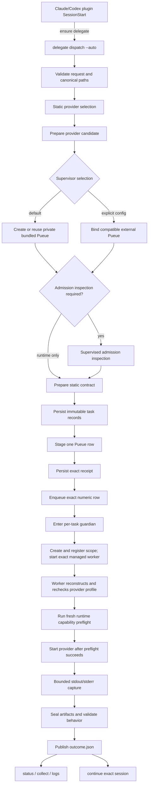

# Architecture

Delegation Layer separates request durability, supervisor control, provider
behavior, and result publication. A provider adapter describes a launch; the
shared core owns when a process may start and what evidence can become a
result.

The maintained Archify views are [system components](../diagrams/components.html)
and [ordinary task lifecycle](../diagrams/lead-interface.html). Their editable
sources are [components.architecture.json](../diagrams/components.architecture.json)
and [lead-interface.sequence.json](../diagrams/lead-interface.sequence.json).
The component view includes optional managed Git workspace coordination; the
sequence keeps provider execution separate from its workspace helper operations.

Download the complete diagrams as vectors or images:

| Diagram | SVG | PNG |
|---|---|---|
| System components | [Light](../diagrams/components.light.svg) · [Dark](../diagrams/components.dark.svg) | [Light](../diagrams/components.light.png) · [Dark](../diagrams/components.dark.png) |
| Task lifecycle | [Light](../diagrams/lead-interface.light.svg) · [Dark](../diagrams/lead-interface.dark.svg) | [Light](../diagrams/lead-interface.light.png) · [Dark](../diagrams/lead-interface.dark.png) |

The plugin bootstrap is outside the task lifecycle. It only makes the
provider-neutral control CLI available before the agent can use the skill; the
CLI and its private supervisor still own admission, execution, evidence, and
continuation after dispatch.

## Package boundaries

The CLI composition layer is `internal/app`. Reusable subsystems own their
state and decisions; command handlers compose them and project CLI responses.
Data contracts and pure rules stay separate from filesystem, process, and
supervisor operations.

| Owner | Responsibility | Data / implementation boundary |
|---|---|---|
| `internal/task` | Immutable task contracts and evidence rules | Random ID creation belongs to `task/randomid`; durable records belong to `taskdir`. |
| `internal/provider` | Provider preparation and evidence interpretation | `provider/contract` holds reusable pure facts; adapters do not own process lifetime. |
| `internal/config` | Environment and configuration observations | `config/policy` owns pure defaults and validation. |
| `internal/guardian` | The shared native lifetime state machine | `lifetime` supplies native primitives; production record stores retain durable evidence. |
| `internal/supervisor` | Binding selection, generation recovery, and cleanup authorization | `pueue` provides control operations; its `protocol` contract is pure and its `internal` implementations are sealed. |
| `internal/admission` | Required provider inspection and admission evidence | `inspection/contract` is pure; inspection journals and probes have sealed implementations. |
| `internal/tasklifecycle` | Ordinary turn creation, reuse, submission, observation, and control | Admission supplies validated profiles; task storage and the guardian retain their own journal and lifetime authority. |
| `internal/workspaces` | Managed workspace use, capture, release, and recovery | `workspace/contract` is pure; sealed Git and journal implementations execute its operations. |
| `internal/scheduler` | Optional recurring-schedule storage for one state root | `scheduler/contract` holds pure values, rules, and the `Store` port; the `scheduler` facade adds `Open` and the owner lease; a sealed SQLite adapter is the only database writer. |

Interfaces belong to the consumer that needs them. Passing a primitive or a
recovery operation across a boundary does not transfer policy ownership.
Workspace inspection recovery, for example, calls admission's recovery policy;
the workspace coordinator alone decides whether its reservation can close.
The [maintainability contract](../agents/_data/maintainability-contract.md#subsystem-boundaries-and-maintainability-gates)
and [module registry](../agents/_data/subsystems.json) define the enforced
source budgets, module roles, and exact dependency edges, including tests.

## Ownership boundaries

The CLI validates user input, resolves the catalog entry, and persists the
request. Provider preparation constructs an immutable candidate containing the
command, environment, policy, input/output declarations, and identity
observer. It does not start a process.

Environment selection is explicit rather than ambient. Composition captures
the caller's environment once, then selects the preparation scope at each
historical window: the caller's scope, or a task's recorded scope where that
window replays the saved task. Preparation receives that selected scope and
filters it through each provider's declared variables for the launch
environment. Executable lookup resolves `PATH` from the unfiltered scope
composition selected, never from the process environment, and an adapter does
not substitute a recorded launch environment for that scope. Launch environment
follows each provider's own rules for saved and unrecorded records. No step
swaps the process-global environment. A recorded scope is immutable: task
metadata and the inspection binding use the environment they recorded, and an
explicitly recorded empty scope stays empty instead of inheriting the caller. A
historical record that never recorded a scope keeps the caller's. Successor
creation has one policy. A new task created by the public `continue` command, or
by `dispatch --resume-task` in ordinary or supported interactive mode, is
prepared in the scope its own caller captured. That scope selects the filtered
launch environment, derives the writable roots, and supplies the fresh
applicable capability inspection proof; it also scopes supervisor control and
detached maintenance. The predecessor's immutable request and metadata decide
only compatibility and eligibility, and its recorded environment or roots are
never a fallback. The successor's own metadata then records that scope, so an
admitted successor reconstructs under the existing rules above. The
predecessor's saved supervisor binding remains authoritative for environment
selection: a scope `DELEGATE_PUEUE_CONFIG` that would retarget a private
predecessor's supervisor is suppressed, and an explicit `--pueue-config` keeps
its CLI precedence.
Supervisor control keeps the caller's bounded environment,
separate from provider environments; a detached private-queue maintenance
launch uses the bounded environment of the scope that schedules it. For
supervisor environments, `nil` keeps the standalone inherited default and a
non-nil empty slice is an explicit empty selection that does not inherit
ambient values. Static model-discovery callbacks are unchanged.

Managed runtime-only tasks are admitted from their static request and provider
contract. Immutable metadata records `runtime_preflight_sha256` and an empty
`provider_version`; it does not claim runtime compatibility. Each task's runner
checks version and help inside its guardian-owned lifetime before provider
execution. The final executable, observed version, and digest belong to the
started and sealed task evidence. There is no shared admission capability
cache or second runtime-only inspection worker.

Native policy projections, model discovery, custom runners, and historical
tasks retain their admission inspection contract. At a queued task's start, the
fresh native projection must canonically equal the admission proof unless the
provider candidate supplies a pure refreshed-facts decision. Core consults that
decision only for two well-formed runtime envelopes with valid native objects,
maps its typed refusal to a fixed evidence fault, and treats any other answer
as a contract fault. Acceptance covers only the native facts: the finalizer
receives the fresh observation, the stored proof is never rewritten, and the
finalized profile must still match the recorded environment, roots, policy,
predicate, and artifacts. CCR supplies the decision only for a modeled record,
which ignores an added `--resume-route`. The inspection worker's
non-secret facts are passed to the profile finalizer, which records the
observed version and effective policy in metadata. The inspection binding keeps
the same environment for a queued worker, including when a private daemon is
reused for another task. The version is an observation; advertised behavior
and the executable identity decide compatibility. New profiles record native
permission selections without inventorying provider configuration. MCP servers,
hooks, plugins, skills, and authentication are owned by the provider CLI.
Workspace-write asks for unattended native tool execution; it does not add a
provider-independent sandbox. Historical tasks retain their recorded task and
policy contract; only a fresh provider runtime identity may be refreshed before
launch. Fresh dispatches use the current provider mapping. An ordinary
exact-session continuation is a new task, so its candidate comes from the
catalog's successor operation, which is distinct from reconstruction of an
already admitted task. An immutable existing task is rebuilt exactly from its
own record. A successor keeps the predecessor's recorded compatibility:
the record family, permission mode, historical profile and dialect, predicate
eligibility, and policy mapping. It takes its launch values from the caller's
captured scope instead: the filtered launch environment, the derived writable
roots, the executable lookup, and the fresh applicable inspection proof. A
predecessor's saved environment, roots, or proof are never copied forward, and
an invalid caller scope fails instead of falling back to them. It adds the
successor turn and the exact recorded session. Every production continuation
adapter declares the explicit successor hook: Claude, CCR, OpenCode,
Antigravity, Pi, and Codex's `codex:exec`; `codex:review` does not support
continuation. A generic catalog registration may still omit the hook, in which
case the catalog falls back to its existing-task preparation for custom or
historical registrations. Each production hook moves only an exact eligible
earlier output predicate of the same mode and launch shape to the current one
through that adapter's own rule, and a record of any other revision or profile
keeps its recorded predicate and historical launch contract. Pi upgrades only
its prior fresh-default revision. Codex has no predicate upgrade. CCR still
refuses a predecessor that did not record its environment, and keeps the
route-preserving `--resume-route` launch and model validation; a historical
modeled `--model` alias or provider-only record resolves the alias through the
caller's configuration and does not promise the retained route. OpenCode is the
exception to the preserved launch shape: a successor of a historical native
`opencode run` predecessor uses the current ACP launch, capability, and output
contracts. It resumes the exact recorded session in the caller's scope,
derives its roots there, and never falls back to a new session. A legacy native
Claude record derives a fresh policy proof from the caller's inspection; the
predecessor's record keeps its own. The predecessor's task record, metadata,
and launch plan always stay immutable and keep rebuilding under their recorded
predicate; only the new successor task carries the current one.
An interactive continuation of a supported provider (Codex and Claude) builds the
current interactive profile in that same caller scope. The caller's scope must
resolve the exact recorded session handle: there is no fresh-session fallback, no
ancestor search, and no copy of the predecessor's configuration, profile, or
authentication. No continuation modifies predecessor evidence.

Immediately before a provider process may start, the runner performs a fresh
capability inspection and receives a current launch plan. A provider path,
reported version, or executable digest may therefore change after admission
when the current CLI still satisfies the adapter's version/help and declared
runtime contract. The runner keeps the admitted task request, predicate, permission,
workspace, writable roots, policy sources, and declared artifacts fixed; a
change to any of those contracts is rejected before launch.

### Runtime-only transition ownership

| Durable facts | Owner / lease | Permitted action | Commit point | Failure / recovery | Consumer verdict | Named test |
|---|---|---|---|---|---|---|
| RT-A1: immutable request, static policy, pending capability digest; no observed version | Application admission / task admission lease | Persist and submit the static task contract | Task metadata and exact supervisor receipt | Reuse the same create-once request and submission | Admitted; runtime verification remains pending | `TestPendingRuntimeAdmissionReconstructsFromTaskMetadataWithoutInspection`, `TestCodexPendingRuntimeV3Reconstruction` |
| RT-L1: required digest in metadata, matching plan, consumed start permit | Task runner inside guardian lifetime / task start lease | Probe this task's runtime and finalize its launch plan | Successful fresh preflight followed by `provider.started.json` | Failed or missing probe seals a rejected result; no second task launch | Execution allowed only after the pending plan marker is cleared and runtime identity is observed | `TestPendingRuntimeRequiresPlanCallback`, `TestPendingRuntimeRejectsUnfinishedPreflight`, `TestPendingRuntimePreflightLaunchesOnceWithObservedIdentity`, `TestCodexMissingNonGitCapabilityRejectsBeforeLaunch` |
| RT-R1: persisted pending metadata and recorded launch context | Application reconstruction / recorded task contract | Rebuild static inputs and compare the exact required digest | Validated reconstructed contract | Capability, environment, or policy drift fails before provider execution | Metadata remains immutable; another task's runtime proof grants no authority | `TestPendingRuntimeCandidateRejectsChangedContractBeforeProbe`, `TestPendingRuntimeBindsImmutableAdmissionMarker`, `TestPreparedProfileMatchesRequiresExactPendingMarkerAndImmutablePolicy`, `TestCodexContinuationPreservesRecordedContract` |

### Managed Git workspace lifecycle

Managed Git workspaces are optional and have one application-level coordinator
as their usage owner. The canonical W1–W7 rows cover committed-base intent,
checkout registration, usage reservation, provider closure, Git-content capture,
release, and explicit forgetting; see the [maintainability transition
matrix](../agents/_data/maintainability-contract.md#managed-workspace-transitions)
and the [agent-facing workspace reference](../skills/agent-integration/references/workspaces.md).
Ordinary non-Git dispatch remains on the existing path.

The coordinator does not delegate Git subprocess ownership to a provider
adapter. Managed Git work runs through the existing supervised lifetime and
execution boundary. Auxiliary helper deadlines are finite operation budgets,
not extensions of a provider task deadline. Capture and cleanup require exact
native closure and the managed worker's disposition first; owned native proof
controls whether cleanup may proceed. Provider outcomes remain immutable and
separate from Git-content capture receipts. The Lead decides whether captured
changes are applied, committed, branched, or merged.

Native worktree add, list, unlock, and remove commands take an exclusive lease
on the shared Git common-directory inode. This prevents concurrent Delegate
helpers from reading Git's partially published worktree metadata, including
across state roots. The command inherits the descriptor through the existing
launch wrapper, so a helper's exit cannot release a live Git command's lease.
Provider turns and content capture remain concurrent. Other repositories use
different inodes, and external Git commands do not participate in this lease.

After provisioning, the shared Git common directory, not the source checkout,
is the repository identity for capture, ref, and cleanup commands. Its inode is
pinned when the source is recorded, so a child survives removal of a transient
parent checkout, including a sibling managed workspace used as its source, and
a replaced repository is refused. Only the new workspace's own anchor must be
disjoint from the source, Git, and state paths.

Each managed provider turn records a baseline at the last preflight boundary
before provider start, inside the task's own lifetime and deadline. It uses the
same private-index algorithm as capture and pins the observed tree. Any baseline
failure refuses that launch. Capture keeps the cumulative base-to-final tree and
also reports the turn's observed tree, HEAD, and real-index changes. The index
identity frames the digests of two streamed plumbing reads: the
`ls-files --stage -v -z` inventory, and `diff-index --cached` against the empty
tree with intent-to-add entries invisible, which separates an intent-to-add
entry from a staged empty file. Flag-only and intent-only edits count;
stat-cache refreshes and HEAD-only moves do not. Capture copies the real
index, opened once, into a private read-only image, and both reads use that
image, so they describe one observed index; a missing index is read as empty.
HEAD and the worktree remain separate observations. Replace refs are ignored,
and a Git that cannot hide intent-to-add entries fails the capture. An observed turn also exports a
baseline-to-final patch and name-status pair through the same bounded export
as the cumulative pair; forget removes both pairs. Task status and collect
project the task's own reservation; workspace status reports the latest use.

One shared reader assembles task, inspection, and workspace lifetime evidence in
reverse dependency order. The pure closure resolver validates that set; individual
consumers do not infer closure from a required pair of hashes. Recovered absence
and previous-boot termination can prove closure without a native Wait. A validated
helper result remains usable across the previous-boot recovery publication gap.
Operational result-read errors leave capture retryable. Recovery completes a
published capture receipt without rewriting its original evidence or disposition.
The coordinator's fixed control window covers receipt publication and
reservation closure even when a short watcher expires. Nested operations keep
that window; helper launch and execution retain their original deadlines.

Failed workspace helpers retain a bounded `error.txt` artifact when its bytes can
be durably written. Public responses expose descriptors; they do not inline that
diagnostic. File closure and directory synchronization precede result publication.

Git checkpoints reuse the same workspace-operation runtime; see rows CP1–CP7
of the [transition matrix](../agents/_data/maintainability-contract.md#managed-workspace-transitions)
and the [checkpoint guidance](../skills/agent-integration/references/workspaces.md#git-checkpoints).
The workspaces coordinator (`internal/workspaces`) owns admission,
scheduling, qualification, removal registration, and description. The Git
owner prepares the full-tree candidate through the capture private index,
writes its stored payload, and pins or deletes the create-only owned ref; it
never moves `HEAD`, a branch, or the real index. The operation journal owns the
immutable creation request, candidate, creation receipt, and the append-only
removal attempt references and receipts. The application layer only parses,
opens the store, calls the coordinator, and projects its acknowledgement and
descriptions to JSON and exit codes. An ordinary checkpoint owns no workspace
resource or lease. A managed checkpoint is a workspace use under the use-owner
lease and its reservation, and it closes without content capture. Success
requires the helper's exact native `Wait`; recovered or unlaunched closures
qualify only as `unavailable`. Creation history is a stored receipt; current
availability is derived from registered removal attempts. Workspace forget
does not remove checkpoint refs. No landing, restore, or nested-lifetime
control is part of this boundary.

Pueue owns scheduling and worker-row state. One application lifetime state
machine owns native-lifetime transition policy for both the live guardian and
recovery. Task or inspection storage owns its durable lifetime records. The
execution runner owns provider `Start`, pipes, capture, and `Wait`. The live
guardian retains its native scope handle and lifetime-owner lease through
finalization; only the state machine may dispose a native scope. Every normal install carries the
matching `pueue` and `pueued` executables and creates a private state-rooted
configuration on demand. Release archives keep the pair beside the CLI;
Homebrew installs it in the formula’s private `libexec` directory so it cannot
conflict with another Pueue installation. The CLI resolves either layout
without requiring separately managed Pueue. Commands that need supervisor
control recover that private daemon from the saved binding after a restart. For
the private supervisor, the state-rooted config path, config digests, and
endpoint define durable identity. Executable paths, hashes, resolver details,
and observed versions remain provenance; a live daemon is adopted only after
the resolved Pueue client successfully reads and parses its status through that
private config. Fresh configs use the ordinary state-rooted socket name when it
fits the host's Unix-domain limit and a compact name in the same private
supervisor directory otherwise. Delegate validates that path before publishing
the config. It can atomically repair only its exact legacy over-limit config
when an unfinished bootstrap journal proves ownership and no daemon or
generation record exists. New private bindings use a verified content-addressed
client/daemon pair under the state root. Recovery reuses the saved executable
pair when it is available. A different verified client may inspect a compatible
active endpoint without changing its generation, but it cannot start or publish
its own daemon over a stopped active generation. When the saved active pair is
unavailable at its old installation paths, ordinary recovery may restart the
exact retained bytes under their protected state-root paths after proving the
endpoint and recorded process absent. The bootstrap journal retains both exact
bindings until readiness-gated publication completes. A different binary pair
requires explicit journaled supervisor migration. Automatic path relocation
also requires that neither identity is referenced in migration history;
history-connected generations use the explicit migration protocol. A legacy
binding without daemon identity is recovered only through a resolved pair and
the normal private config and endpoint checks. Launch provenance is atomically
recorded after readiness. New private daemon launches inherit the spawning Go
process's available soft file-descriptor limit, within the OS hard limit,
instead of Go restoring a lower pre-runtime limit for that child. This affects
child inheritance in the current short-lived Delegate process; it changes no
limit value or system-wide setting and does not restart an existing daemon. The
daemon also starts in its own Unix session, so a signal to the invoking CLI's
process group cannot terminate the private supervisor.

The completed supervisor identity is the sole active-generation record. Daemon
identity records launch provenance. A proven same-byte path split may replace
only the erroneous supervisor binding under the bootstrap lock, leaving daemon
provenance and task history byte-for-byte unchanged. Pending transitions and
migration-history references prevent this metadata-only relabeling. The
state-root executable-pair record is verified successor inventory until fresh
bootstrap or explicit migration publishes it as active. The ordinary-scheduling
receipt proves default-group policy and the staged add/enqueue command surface
for the exact active generation; it never selects executables. This lets an
install upgrade stage a compatible pair while
ordinary admission keeps using the published daemon and its queued work. A
launch-path or digest change alone does not rewrite a live generation. The
metadata-only reconciliation above repairs an inconsistent binding to its
existing launch witness. Ordinary controls share a lease on the supervisor generation, allowing
independent tasks to proceed concurrently. Startup and migration take the
exclusive form of that same lock. An unfinished control command retains its
lease until its process is reaped. Healthy probes reuse a published client
version only after verifying the same executable bytes and resolution; they
still observe the live endpoint. Once Delegate has published both the generation
identity and its exact-generation ordinary-scheduling receipt, warm admission
checks those records and connects to the private Unix socket under the shared
lease without launching a Pueue client process. A missing or refused endpoint,
a changed binding, or a stale receipt enters one elected exclusive path, which
uses Pueue's group protocol before it repairs policy or restarts anything.
Changed bindings use normal version discovery. The staged command surface is
probed only while repairing that exact-generation receipt; warm submissions
and staged recovery consume the recorded capability without repeating help
commands.

Existing-task status uses saved-generation recovery independently of admission.
Scheduling and queued-runner repair retain their existing owners for complete
generations. A published predecessor with matching prepared intent remains
observable before shutdown; it grants no new submission or repair authority.
Task-status reading rechecks that phase inside its shared lease before reusing
cached rows or reading fresh ones. If migration wins before optional repair,
only an explicit pre-mutation completion refusal can defer that repair, and
status must obtain a fresh canonical observation. Stashed tasks still need
their matching durable receipts and remain stashed while enqueue is deferred.
Deferral belongs to that observation attempt. A later collection poll starts
with fresh preparation, so an earlier refusal cannot suppress healthy recovery.
Unrelated faults and unfinished commands keep their existing failure and
ownership semantics.

| Durable facts | Owner / lease | Permitted action | Commit point | Failure / recovery | Consumer verdict | Named test |
| --- | --- | --- | --- | --- | --- | --- |
| `UPG-01` Verified staged pair | Application / bootstrap lock | Bind exact returned immutable paths | Pair inventory publication | Revalidate exact pair, independent of inventory pointer | Inventory never selects active generation | `TestMigrationPreparesInstalledPair` |
| `UPG-02` Inspection predecessor and matching daemon provenance | Inspection adoption / bootstrap lock | Create missing predecessor binding | Create-once binding | Preserve conflicting provenance | Prepared successor cannot become predecessor | `TestInspectionPreservesVerifiedPredecessor` |
| `UPG-03` Same hashes, retained daemon witness, no pending edge or history reference | Application eligibility + Pueue publication / bootstrap lock | Replace erroneous binding paths only | Atomic binding replacement and directory barrier | Reread ambiguous writes | Daemon and task records unchanged | `TestPublishedPairReconcilesPathSplit`, `TestAdmissionReconcilesPublishedPair` |
| `UPG-04` Coherent binding, missing install paths, exact retained pair, stopped endpoint and process | Pueue bootstrap / bootstrap lock | Persist exact restart intent, then start that pair | Readiness-gated identity transaction | Resume recorded target; publish an already-ready restart without relaunch | Same-byte generation available for admission and saved-task recovery | `TestPublishedPairRestartsExactRetainedPair`, `TestPublishedPairRestartRecoversLaunchBeforePublication` |
| `UPG-05` Conflicting bytes, history reference, or unfinished transition | Existing transition owner / bootstrap lock | Preserve state and classify blocker | No replacement | Retain explicit migration path | No automatic generation substitution | `TestSupervisorUpgradePreservesConflictingState` |
| `UPG-06` Old installation removed, explicit successor prepared, inspection predecessor retained | Explicit migration / bootstrap lock | Observe predecessor, refuse active work, gracefully drain, start successor | Existing migration journal and ready identity publication | Resume journal and resolve actual active generation | Report migrated only for committed active binding | `TestSupervisorMigrateReplacesRemovedPackagePair` |
| `UPG-07` Immutable inspection head predates same-logical private upgrades | Canonical generation resolver / bootstrap lock | Select actual private predecessor or prove completed connected target | Exact prepared inspection edge completion | Re-resolve lineage; a direct private edge from the historical head is not required | Preserve the head while using the authoritative active generation | `TestInspectionMigrationUsesActivePredecessorAfterPathRelocation` |

Pueue's terminal callback triggers maintenance after a row reaches `Done`;
dispatch records the admission verdict and does not wait for cleanup.
Every current ordinary and inspection submission installs a callback ticket
before enqueue. Its callback publishes an ID-scoped candidate event before it
requests maintenance. When the callback is delayed, exact admission observation
revalidates an ended inspection row under queue identity and publishes the same
event. That accepted observation starts an independent `delegate-run`
maintenance process, so cleanup survives the observing CLI without extending
admission.

The event directory is the durable candidate inbox; it remains recoverable even
if the generation-journal write or process handoff fails. The per-root journal
owns requested, attempted, successful, and full-recovery watermarks. The
election lock alone identifies the live owner. A callback that loses the
nonblocking election returns immediately. The winner waits for a short bounded
quiet interval, captures the latest generation, and handles the completion
burst in one pass. It rechecks the durable journal after releasing ownership,
so a wake published during final handoff is either drained by that owner or
wins the next election. Requests arriving during a pass remain above the
attempted watermark and receive the same quiet interval before a later pass.
A control command that outlives its finite observation window remains owned
through natural completion and does not consume the generation early. Before
retrying, that owner observes release of the retained election lock, so it
cannot misclassify itself as a competing owner and strand the durable wake. A
released interrupted pass is recoverable; a finished failed attempt waits for a
later trigger instead of looping. Validated root activation also resumes retained
inbox or journal work.
Under the event lock, maintenance also removes exact-shaped temporary publisher
files left by an interrupted create-once write. Those files never carry event
authority. Committed numeric filenames and payloads still receive strict
validation, and unrelated entries remain errors.

Normal passes stream one queue snapshot and expose only event-backed numeric
IDs to Delegate's cleanup policy, for both ordinary and inspection rows. Every
same-label row remains visible so ambiguity cannot be hidden. A conservative
full-recovery wake is used when candidate publication fails or a historical row
has no ticket; it exposes the complete current snapshot, including inspection
rows with missing candidates. Durable task and inspection journals
remain the sole authority for every removal. A later callback or accepted
terminal observation wakes a retry for rows retained by an earlier failed pass.
A failed attempt never re-runs itself; it waits for a new positive wake.
For terminal maintenance, a private root whose binding predates the
logical-identity record is adopted inside the asynchronous maintenance helper
(`RunQueueMaintenance`), not by a public observer, under the bootstrap EX lease, from the existing config, recorded daemon identity, and
resolved executable pair. It never creates a config, starts or restarts a
queue, or relaxes a hash check; a refusal keeps the wake pending. Adoption goes
through the existing `PreparePrivateWithLock`, whose status-overflow cleanup of
authorized successful rows can still run under that EX lease. Migration keeps
the relevant inspection rows, so a later full pass can retry their custody.
Adoption enters only an existing bootstrap lock: a deleted root, a root without
`.supervisor`, or a missing bootstrap lock returns
`ErrPrivateSupervisorNotInitialized` and creates nothing. The callback recorder
likewise enters only an existing terminal-event lock, recovers interrupted
stages under it, and rechecks its ticket there; a missing lock records no
candidate and the helper requests a full wake. Ticket publication still
provisions that lock.

Canonical lifetime closure and empty custody do not prove that elected
maintenance finished: Pueue 4.0.4's shutdown waits for task children, not
callback helpers (upstream source, not a native observation). The
acceptance harness's final disposal (`finalize_fixture`, the workspace context
cleanup, and the candidate-install bootstrap, which shares one value across its
shutdown and canonical owned-root removal) therefore owns one `DisposalLeases`
value from each authorized shutdown through exact root deletion. Per root it
first opens the existing `transition.lock` and `bootstrap.lock` without creating
them, and only then opens or creates `queue-maintenance.lock`, so a refused root
is left exactly as found. It flocks `queue-maintenance.lock`, then
`transition.lock`, then `bootstrap.lock` EX
within the caller's existing deadline, waits for readiness outside the current
root's lease, and releases only that root's lease before its custody wait;
roots it already shut down stay held through deletion. The remover refuses a
managed root that still has `.supervisor` without that held lease and rechecks
closure and custody under it. The lease excludes elected maintenance only; it
does not prove that callback helpers exited, so a late write or deletion fault
retains the root and reports an error. A lease release fault at teardown is a
cleanup error: `finalize_fixture` still writes its one FAIL receipt with the
original failure and the actual removed or retained root state. Mid-scenario
shutdowns and historical fixture seeding keep the transition lease alone.

A queue writer publishes intent under its dedicated owner lock before waiting
for exclusive queue identity. New readers check that intent before and while
crossing the short gate, so a continuous submission stream cannot overtake the
writer. An abandoned intent is cleared only after exclusive acquisition proves
its writer is gone. The initial snapshot, candidate selection and application
evidence preparation share queue identity. Preparation preserves exact legacy
inspection exit observations before removal and uses nonblocking lifetime
recovery; it never rebinds a supervisor or schedules workspace work. Migration
performs that phase under its existing exclusive bootstrap owner. Application
authorization then reads the durable evidence without queue identity;
maintenance then takes a fresh same-scope snapshot under the exclusive identity
mutation, verifies every authorized terminal row is unchanged, removes those
exact IDs, and retires callback state after successful removal. Failed removal
keeps the event for retry. Every new submission resets callback classification
before enqueue while holding queue identity, preventing an old hint from
crossing numeric-ID reuse. Queued inspection stops do the same before their
authorized `remove`. If durable evidence is terminal while the row still
reports running, maintenance releases queue identity during settlement and
reacquires it for a fresh snapshot. The stable callback helper path is
atomically refreshed for compatible implementation upgrades, so an existing
daemon receives current behavior without callback-config drift.
Every supervisor command inherits duplicates of all nested generation, writer,
gate, and identity leases held by its caller. A finite observer timeout or
caller exit therefore cannot release an outer lifecycle lease while the owned
command can still mutate the queue.
Maintenance failures do not change task outcomes. A real logical
config or endpoint migration is explicit and runs under the state-root lock:
it proves the queue is safe, shuts down the old endpoint through its client,
starts the current bundled daemon, and then replaces the launch record. Before
shutdown it creates `.supervisor/migration.json`, then atomically advances its
recorded PID and shutdown phase. Recovery preserves that progress. After shutdown
is recorded, recovery finishes the recorded successor before considering a later
installation. Normal execution and recovery share successor publication and
cleanup; they remove the journal only after identity and recovery alias are
settled. The process starting a daemon owns an asynchronous waiter so exited
children are reaped without blocking startup. An explicit
`--pueue-config` can bind an existing compatible supervisor.

An external inspection journal can move its future routing to the private
supervisor during default private admission or model discovery, or through
the explicit `supervisor migrate` command. These paths use the same
application-owned journal handoff, separate from private daemon migration.
The private lifecycle first proves its live target and publishes its logical
binding without replacing an existing daemon identity. The existing inspection
prepare/complete journal then commits the exact successor. Publishing the
private binding first pins that target across a crash or installation upgrade.
Status follows completed edges from the original journal rather than rejecting
an external seed whose handoff is already complete. Old tasks and inspections
continue using their immutable saved bindings; no external daemon, queue, or
operational record is changed or removed. Active work can continue on either
supervisor, so this routing handoff needs no queue drain or admission fence.
The warm shared probe only elects repair; the existing exclusive bootstrap
owner commits it. Other migration errors remain explicit failures.

`delegate-run` receives the saved root and task ID plus an internal
supervised-launch marker.
Dispatch uses `add --stashed --print-task-id` so the exact row cannot run while
its receipt is being published. It records that numeric receipt against the
immutable task and only then issues `enqueue` for that ID. A receipt-write or
enqueue interruption leaves the same stashed row for exact status recovery; it
never permits an unrecorded runner to start and never authorizes another add.
Once scheduled, a marked runner validates the durable receipt and opens the
saved binding without bootstrapping, migrating, or scanning the queue. Managed
inspection workers use the same staged protocol, including terminal-event
registration before receipt commit and enqueue. Their guardian owns the exact
child `Wait`, completes the shared empty-scope finalization policy, and durably
records both facts before the scope can be disposed or its owner lease released.
Successful exit evidence remains bound to the worker's completed inspection
record. An exact failed exit is terminal unavailable evidence even when the
worker failed before writing that completion. Legacy and custom inspection
workers, missing local evidence, and direct ordinary runner invocations without
the marker retain bounded Pueue reconciliation. This keeps lifecycle control in
dispatch and observation while allowing many workers to finish without
per-completion control-plane fan-out. The runner then
reconstructs the recorded profile and refuses to start if the fresh profile no
longer matches admission. The runner observes provider
identity, captures bounded streams, verifies declared artifacts, and seals the
evidence. The final provider executable, observed version, and digest are also
written to `provider.started.json` and `provider.exit`, so a runtime upgrade
remains reconstructable without rewriting immutable `meta.json`.

The guardian holds one lifetime-owner lease across the complete native
transition. It records a deterministic scope intent before creating the scope,
then records the scope registration before starting the managed worker. The
worker's exact process identity is durable before its hello is acknowledged.
Every successful provider start is observed and recorded before the worker may
continue. Finalization fences the worker, proves the scope empty, records that
termination, records `not-started` or waits for the exact managed-worker child
and records that `Wait`, disposes the empty native scope, and finally releases
the guardian's scope handle and owner lease. A live guardian retries its current finalization phase
with bounded attempts and capped backoff; it does not release reconstructable
authority while native cleanup remains unresolved. User cancellation first
persists its stop request. Active guardians check durable stop evidence on a
one-second cadence and retain full prepared-record validation on each check.
Task-budget expiry uses a separate timer. The cadence is not a guarantee that
native termination completes within one second.
Provider-start, provider-finish, and normal provider-close control use the
immutable task or inspection deadline, including native process-scope
observation. They do not replace that deadline with a shorter local control
timeout. Terminal stop and recovery after the work deadline use the guardian's
separate finite cleanup fallback because they must finish already-started
lifecycle work.
When the guardian owns the lease, it observes that request and performs the
same native finalization; cancellation never kills the Pueue row out from under
that owner. A canceller may remove or stop the queue row directly only after it
acquires the lifetime-owner lease itself, which fences guardian and provider
startup. If that supervisor mutation has started but outlives its observation
window, the canceller retains the lease until the command's single `Wait`
settles; returning first would reopen provider startup while an older mutation
could still stop its guardian. Recovery enters the same finalization policy
from the last durable phase. Deterministic scope collisions use that policy
while the owner lease remains held. A setup write error is re-read and an exact
matching registration is replayed before terminal finalization; unverifiable
registration state fails closed without destroying the scope. Linux uses an
identity-bound delegated cgroup v2 when
available. Darwin and Linux hosts without delegated cgroup control use
cooperative private sessions. On Linux, the guardian becomes the sole child
subreaper before starting its worker. The exact guardian and worker identities
anchor topology discovery but are never signal targets; only adopted task
zombies are reaped, by exact PID, after the worker retains its single `Wait`.
While the exact Linux owner is live, two fresh topology observations retain
identity-verified descendants across nested groups and sessions without reading
unrelated process environments. Reaped zombie observations may bridge one
topology generation, but they are never signal targets. After owner loss, a
cooperative scope may terminate processes with durable identities and connected
descendants, but it cannot prove the scope empty or publish terminal evidence.
Darwin has no subreaper primitive, so its live guardian combines topology with
the inherited per-task marker. New launches use a private session. Each
discovered process is matched to its stable Darwin unique identity, its current
pidversion is refreshed immediately before an audit-token signal, and nested
groups or sessions are rescanned until empty. Immutable legacy records retain
their historical process-group pin only while they drain. Ownerless recovery
fails closed there as well.

Pueue compatibility is behavioral at this boundary. Delegate requires the
observed client and daemon version output to be nonempty and well formed, and
requires the status fields and lifecycle variants it consumes; it accepts
additive version text and status fields. It does not use a release-version
allowlist for an installed Pueue. The bundled Pueue release remains pinned in
the build inputs so shipped artifacts are reproducible.

The private Pueue state is an operational control surface, not Delegate's task
history. Status is parsed one bounded task/group record at a time, retaining
only scheduling and identity facts; the aggregate queue is not subject to the
1 MiB control-record limit. Other control responses and individual status
records remain bounded. Provider environments are not retained in the parsed
snapshot.

Terminal-callback maintenance selects exact terminal rows whose Delegate
receipts and outcomes validate. It uses the same evidence checks as migration
and removes only those numeric IDs. Active, incomplete, malformed, or unrelated
rows stay intact without vetoing cleanup of validated rows. Cleanup is outside
the dispatch critical path and one elected pass can retire many completed rows.
For every fresh inspection worker, admission derives exit authority from the
guardian's create-once completion disposition and independently proven
empty-scope termination. The disposition is either the started child's exact
`Wait` or `not-started` with no process identity. Admission reads that evidence
before checking its wall-clock deadline or polling Pueue. Terminal events and
exact labeled status remain wake-up signals for this path; they
cannot replace the guardian proof. Historical markerless inspections retain
the queue-observation fallback. Both successful and failed managed worker
exits are retained; a failed worker does not need to fabricate a local
completion record. A Pueue row end alone
cannot authorize provider facts, and
duplicate labels cannot publish exit evidence through cleanup or migration.
An exact status command that exits transiently is retried only within the
immutable admission window and its cause is retained if that window expires.
Malformed status, schema, output-limit, binding, identity, and evidence faults
remain immediate failures rather than retry signals.
For a private supervisor, the maintenance step of `status` and `collect` is an
observer (`internal/app/task_maintenance.go`). It reads its own task's closed
custody hint and reconciles its exact published row read-only; it never
removes a row, binds the supervisor for mutation, or releases custody. A
positive hint (closed custody still pending, or the exact ended row still
present) durably requests one full maintenance generation. It publishes that
wake in the guardian's fresh cancel-independent phase bounded by
`pueue.DefaultObservationTimeout` (5 seconds), separate from its own 10-second
observation bound, so an exhausted observation cannot drop the wake; this can
add up to 5 seconds and renews no provider, task, or native budget. The observer then
attempts to start the existing independent maintenance owner only when it holds
a published-row client and a maintenance launcher; otherwise the durable wake
waits for a later callback or admission to consume it. When neither the
custody hint nor the exact row hint is positive, the observer requests
nothing. This optional maintenance step adds no supervisor probe or repair;
the command's own task observation is unchanged. A task with a validated saved external binding has no elected
owner, so its observer keeps the synchronous custody retry and never cleans
rows; a malformed saved binding classifies nothing and never falls back to that
external path. Maintenance faults are logged warnings; the command's outcome,
payload, JSON, and exit code are unchanged. External `--pueue-config`
installations are never cleaned.

The private supervisor's ordinary default group uses Pueue's unlimited
parallel_tasks: 0 setting. The orchestrating model chooses fan-out by issuing
independent dispatches concurrently; Delegation Layer sets no fixed
task-count cap, and Pueue's default group applies no parallel limit. A fresh
dispatch or `continue` is still subject to the
[resource admission check](#fresh-admission-resource-check), which can refuse
the new request; accepted work is untouched. Managed runtime-only dispatches
create no separate inspection row. Their fresh capability check runs within
the ordinary task's finite budget. Required admission inspections retain their
immutable deadlines, including historical 20-second journals. Dispatch prepares
this scheduling policy before admission; this can release previously admitted
queued tasks even if a new request fails. Observation and recovery do not
change scheduling. Saved inspections retain their recorded group and deadline.
Admission and model-discovery inspections use a separate single-slot group.
Default model discovery shares dispatch's private routing handoff; explicitly
selected external supervisors retain their recorded inspection group.
The operating system, provider, authentication, and available resources remain
the practical limits.

Queued inspection workers keep their original immutable worker binding during
an upgrade. New inspection requests persist whether the runner is managed or
custom. Before replacing a queued managed worker command, the CLI records a
create-once authorization tied to that inspection request. The worker accepts
a successor only when its executable is a content-addressed runner in the same
state root and its bytes match that path. Custom workers remain pinned to their
recorded identity; older requests without ownership metadata are treated as
ambiguous and are never automatically rewritten.

Queued ordinary tasks with legacy metadata get a create-once runner-migration
receipt, bound to the immutable task hashes and original runner digest, before
their Pueue command is updated. Continuation and retry use that receipt to keep
the runner classified as managed after its former installation is removed;
the prepared task metadata remains unchanged.

The task store and predicate registry own publication. A committed
`outcome.json` is the terminal authority; `result.txt` and sealed raw streams
are payload evidence referenced by validated descriptors. Collection can replay
that publication without requiring the provider or supervisor to remain
available.

Every prepared-record validation rereads the request, metadata, and brief; none
is cached. A reader that needs only the metadata streams the brief through a
bounded hash instead of retaining it, then compares the full-content digest and
length with the recorded identity, so a truncated or same-length changed brief
is a concrete identity fault. Only the continuation brief read returns the
bytes, as a caller-owned copy. Execution independently hashes the exact
read-only descriptor it hands to the provider.

## Verified executable custody

A managed task or inspection process runs its provider and probe executables
from verified, immutable images instead of a private copy that each command
removes. `internal/verifiedexec` owns the pool: one image per SHA-256 digest
(mode `0500`, never rewritten) and, for each bound command, a private hard-link
view under the owning task's or inspection's namespace. Workspace operations
have no placement and keep their private copy.

- **Placement owner.** The guardian chooses one placement after confirming that
  no lifetime registration exists and before it creates the native scope or
  registers a worker. The create-once registration records it as the optional
  version-1 `custody_placement` (`pool_root`, `pool_id`). Afterwards the
  registration is the only authority: the worker, `status`, `collect`, and
  cleanup read it and never reselect or recreate a pool
  (`internal/guardian/registration.go`, `internal/app/custody.go`).
- **Selection.** The preferred pool is `<state root>/.custody`. Only when every
  cause of its refusal is a native, confirmed `noexec` mount (Linux and macOS)
  does selection fall back to `<canonical TMPDIR>/delegate-custody-<RootID>`.
  `TMPDIR` (default `/tmp`) and the working directory are captured once from the
  guardian's environment; a relative `TMPDIR` resolves against that directory.
  The fallback is a different location of the same pool design, with its own
  identity marker. Any other refusal of the state-root pool fails the guardian
  run directly with its own cause, before it creates the scope. Only when the
  fallback was attempted and also failed does the error name both causes.
- **Release.** The recorded pool identity and canonical native closure govern
  release. Closure is proven only by the canonical journal reader
  (`guardian.ReadClosureProof`); a dead process, an unheld lock, or an inherited
  descriptor is never evidence, and pending closure releases nothing. The
  guardian's post-run release is the primary path, bounded at 10 seconds. For a
  private task, a release fault persists a full maintenance wake before the
  guardian exits, in its own cancel-independent phase bounded by
  `pueue.DefaultObservationTimeout` (5 seconds); it renews no provider, task,
  or native budget. That write is best-effort I/O: its failure is logged, not
  guaranteed away. For an external task, the next `status` or `collect` retries
  the release synchronously. A custody fault never rewrites the task outcome or
  the guardian's result.
- **Private maintenance custody.** The elected private maintenance owner
  (`internal/pueue/internal/control/private_queue_cleanup.go`) calls the
  application releaser `releasePrivateTerminalCustody` with neither the
  generation lease nor queue identity held. A full generation first calls it
  with no candidates, before the queue endpoint is captured, and it retries
  closed custody for every ordinary task listed by `taskdir` `TaskIDs`, so a
  removed row, lost callback, or stopped queue cannot strand custody. Each
  capture then prepares evidence under queue identity, hands a deep copy of its
  candidates to the releaser, and removal reacquires both leases for fresh
  revalidation. Candidates, task-directory names, outcomes, and row absence are
  discovery only; the exact recorded pool and canonical closure remain the only
  release authority. A custody fault fails the attempt without withholding
  other authorized rows; a later positive wake retries it.
- **Inspection cleanup.** After an ended inspection row's lifetime evidence
  validates, maintenance releases its closed custody. Removing that row, once
  its terminal evidence also validates, additionally requires that no custody
  remains pending, so an unavailable pool retains only that row until a later
  pass. This availability gate applies only to removing an ended inspection
  row. It does not gate active-task or task-row cleanup, native evidence
  validation, or explicit migration. Launches are not exempt: a worker binds
  through the recorded pool and proves its identity first.
- **Unresolved pools.** A missing, replaced, foreign, aliased, or otherwise
  unavailable recorded pool stays unresolved and retained with its concrete
  cause. Delegate does not repair it, reselect another pool, or treat a missing
  pool as released. A registration without a placement predates custody: its
  record keeps its legacy bytes and digest, it is never released, and a worker
  refuses to start a task or inspection from it. Older strict binaries decode
  records without unknown fields, so they are not guaranteed to read a
  registration that carries a placement.
- **Footprint.** Images are shared across owners. An image stays until no view
  links it; idle reclaim then removes it best-effort after a bind or release.
  There is no TTL and no background service, so the footprint of an image whose
  owner is unreleased persists until canonical release.
- **Noexec scope.** The fallback covers a noexec state root used with an
  external supervisor. A private bundled supervisor pair is stored below the
  state root (`.supervisor`, `internal/supervisor/pair_publication.go`), so it
  cannot run from a noexec state root and the fallback does not change that.
- **Assurance limit.** An image covers only the files `verifiedexec` binds by
  digest: the admitted entrypoint and, for a supported interpreter script, its
  interpreter. Shadow paths preserve provider-owned dependency lookup through
  links to the original installation. Later-loaded shared libraries and
  imported modules (for example `node_modules`) remain live and can change
  after binding. A matching
  entrypoint digest is therefore not proof of the identity of the provider's
  runtime dependencies, and Delegate does not hash them
  (`internal/verifiedexec/verifiedexec.go`, `newCommand` and `shadowDirectory`).
- **Threat model.** The pool checks are a static check of a private directory
  owned by the current user: canonical path, no alias, one filesystem, and the
  recorded identity marker. They do not defend against a hostile process of the
  same user mutating the pool concurrently, a physically cloned disk, or power
  loss.

## Native output and derived recovery

The core owns captured files and callback-scoped readers. Provider adapters
interpret bounded views of records, selecting the fields their completion
contract uses and streaming answer text into core-owned staging. Unused tool
payloads and metadata are skipped without retaining an entire native event.
JSON syntax remains validated; consumed identity and completion fields remain
unambiguous. Optional accounting cannot veto an otherwise valid answer.

Historical predicate revisions remain registered for reproducible collection.
New tasks select corrected revisions. Explicit `recheck` uses a separate
adapter-declared recovery interface with the original sealed input unchanged;
it never substitutes a newer reference into the old seal. The task store
verifies the source records and complete evidence, then publishes a derived
answer and immutable report under `rechecks/`. Payload publication precedes
report publication. The original terminal outcome remains authoritative for
task lifecycle and continuation, even when a derived answer is recovered.

## One turn and continuation

Each task has one immutable request and at most one provider launch attempt. A
continuation is a separate task that points to one exact predecessor. The
provider conversation reservation remains held until the predecessor has a
validated terminal outcome or a durable Pueue-ended budget-stop observation
backed by a guardian lifetime-termination record with independently proven
empty scope, or canonical closed lifetime evidence with a free runner lease
for a turn with unknown publication and no seal or outcome, then the layer
releases ownership for the successor. A sealed turn is collected first. This evidence permits
session handoff only; it does not publish task completion.
This makes retries and recovery explicit rather than implicit replays.

Closure has one owner, `task.ResolveLifetimeClosure`; any canonical closed kind
qualifies, and a queue end or timestamp never does. The existing session journal
owns release and the task outcome stays separate. Release records are immutable,
so the proof stays valid when compatible absence, budget, or outcome records
arrive later. Handoff generates no budget stop, `Wait`, seal, outcome, or
session identity. Without a fresh `provider.ref`, a validated immutable
requested prior session may stand in only when that record is genuinely absent;
it is a requested input, not proof that the interrupted provider persisted
messages. After a host restart, `status` and `collect` report such a closed,
unsealed task as `interrupted` (`task_interrupted`, publication `unknown`, no
outcome). Cancellation and stops take precedence over automatic continuation.

The public `continue` command is a thin path over that existing continuation
boundary. It reuses the validated predecessor brief unless a follow-up brief is
supplied, preserves the provider session identity, and creates a new task
record. Ordinary successors keep the predecessor's recorded compatibility and
historical mapping but launch in the calling process's captured scope, as
described under environment selection; fresh dispatches select the current
mapping. An interactive successor uses the current interactive contract in the
same caller scope while preserving the exact recorded session. It does not
reconstruct the predecessor's preparation contract. The working directory,
permission mode, and session stay those of the predecessor, and existing model
and effort validation and the budget rules are unchanged. A timeout response
advertises this path only after durable budget-stop termination evidence is
present.

## Fresh admission resource check

Before a new task is created, `dispatch` and `continue` check whether the host
shows confirmed resource pressure. The task lifecycle owns the authorization.
A single resource-admission package owns the observations and the pure
decision. Observations belong to one invocation: nothing is persisted, cached
across commands, or kept in a global. The summary in the response is
invocation-local and is not durable task state.

- **Placement.** A fresh dispatch is checked before workspace or provider
  preparation. A `continue` is checked after the predecessor loads and before
  workspace preparation; its shared admitted flow does not repeat the initial
  check. Before ordinary task creation, a fresh dispatch refreshes the check
  only when the last observation is older than 5 seconds (monotonic) or the
  supervisor, execution target, or cgroup membership changed. A refusal at
  that late point still creates no task record, capture, or ordinary provider
  run, but earlier provider inspection may already have run, so no refusal
  claims that every provider process was avoided.
- **Cost.** A normal check takes about 1 second. A confirmation needs 3
  intervals. A 4-second sampling budget bounds the waits and tick boundaries
  between samples. It does not bound a blocked operating-system read or the
  aggregate memory of concurrent invocations, so there is no universal
  wall-time guarantee.
- **Decision.** Confirmed, trustworthy pressure refuses the new request.
  Healthy or cleared readings admit it. An unreadable or unreliable metric
  admits it with a structured warning and `resource_admission.status:
  "unknown"`; an unknown metric never refuses by itself. Confirmed pressure on
  one metric still refuses when another, independent metric is missing.
- **Signals.** Host CPU is busy at 95% or more for 3 consecutive intervals of
  about 1 second. Linux host memory is low against a reserve of `min(1 GiB,
  10% of RAM)` for 3 consecutive samples after the initial baseline, or
  critical (below half the reserve) immediately. macOS reports memory-pressure
  warning for 3 consecutive samples after the initial baseline, or critical
  immediately. A low or warning baseline alone does not count toward the 3.
  Inside a Linux cgroup v2 target, a working-set
  estimate (`current` minus `inactive_file`) is only an estimate, not
  guaranteed reclaimable memory, and cannot refuse on its own. A cgroup memory
  refusal also needs the execution target's memory PSI `some` total to grow by
  at least 1% of each interval for 3 consecutive intervals. Missing PSI,
  cgroup v1, an unresolved scope, or an unreadable file makes only that
  dimension unknown with a warning.
- **Not covered.** This is a refusal guard for new requests. It is not a
  queue, a background retry, an automatic wait, or a controller. It does not
  kill, pause, throttle, or offload work, and it adds no task-count cap: the
  model still chooses fan-out. It cannot promise that a started task avoids
  out-of-memory kills or that capacity is reserved. On Linux it observes only
  the visible cgroup hierarchy. A private cgroup namespace can hide higher
  ancestors even when the visible mount root is `/`, so a memory or CPU limit
  set outside the namespace is not seen and its pressure is not detected.
- **Untouched paths.** Recovery of an existing or partly created task, an
  uncertain task ID, accepted work, `status`, `collect`, `cancel`, and cleanup
  are never gated.

A pressure refusal is `task_record: "not_created"` and is the only response
that carries `retry_later` with `failure.retry_after_seconds`; see the
[CLI reference](cli-reference.md#resource-check) for its fields. The refusal
reports a sample, and `not_created` is its only authoritative task state. An
explicit task ID whose absence cannot be proven stays `task_record: "unknown"`
with stop guidance. No response promises that pressure is absent on every
other path or later.

## Runtime discovery

Provider registration is static and cheap. Host compatibility is dynamic: the
adapter locates its executable, checks that it is executable, runs version and
help, and verifies the stable flags it can observe reliably. This accommodates
provider releases that change their version number or omit forwarded options
from pipe-based help output while preserving the runtime entrypoint contract.

Three identifiers stay separate. The observed harness version is the release
the provider reports; it is evidence, never an admission allowlist, and never
selects a parser. A negotiated protocol version, such as OpenCode's ACP
`protocolVersion`, is a capability that must be negotiated before a session
starts. The Delegate interpretation revision is a predicate reference's
`Version` and `SHA256`: the immutable local identity of how sealed output is
interpreted. It changes only when Delegate's interpretation changes, for
example when Claude's current revisions began publishing every accepted root
answer and reporting a correlated quota failure. A provider release alone never
changes it, and every saved task replays under its recorded revision. When a
candidate carries a runtime probe, a queued or retried task may run a newer
executable or version after a fresh probe while its recorded policy and
predicate stay bound (`internal/admission/profile_binding_policy.go`). A
candidate without a runtime probe, such as a custom or legacy binding, keeps
exact matching; no binding upgrades automatically. A CCR modeled record on a
CCR that newly advertises `--resume-route` keeps its recorded modeled argv and
predicate; only that one-direction addition is accepted, and a route-preserving
record whose CCR stops advertising the flag is still refused. A native proof
showed modeled session and model preservation on a route-capable CCR, but no
real CCR release upgrade between admission and launch has been observed.

The implemented `delegate models` command is a separate advisory path. It
reuses the state-rooted supervisor and runs one bounded native model inspection
with the `model-discovery-v1` five-minute window, allowing first-run provider
model/cache initialization and recording sanitized model facts
without admitting a
provider task. Its `complete` flag describes model enumeration; null effort
metadata remains distinguishable from an explicitly empty list. Discovery is
never used as an admission allowlist, and model facts are not treated as proof
that an account can execute a listed model.

## Scheduler storage

Only the storage foundation of the recurring-schedule scheduler exists. No
command, service, or task dispatch uses it yet; the scheduling behavior that
will build on it is deferred. It is unrelated to the pueue supervisor that runs
admitted tasks.

- **Location and creation.** The optional database is
  `<root>/.scheduler/schedules.sqlite`. Only the exclusive scheduler owner
  lease may create or migrate it. `Open` never creates or migrates, takes no
  lease, and reports a missing or uninitialized database as not found. The
  directory and file must be owned by the current user, private (`0700` and
  `0600`), and not a symbolic link.
- **Schema.** Version 1 is the only version. Initialization takes an empty or
  absent file from `user_version` 0 to 1 in one transaction. It creates four
  `STRICT` tables: root metadata, schedules, occurrences, and skip spans. A
  partial unique index allows at most one unreleased occurrence per schedule.
  Every operation on an initialized database first verifies the exact schema
  objects and that the stored root identity matches the state root, before it
  touches domain data. Initialization instead checks that the file is eligible,
  then creates the schema, the root metadata row, and the version in one
  transaction, and verifies the result before it commits. A newer or foreign
  database is refused, never repaired.
- **Authority.** The immutable task files stay the authority for every task's
  outcome. Stored observations are a cache and never authorize a launch.
  Ordinary dispatch, status, and collect do not depend on the database. There
  is no backfill from existing tasks and no relocation of task state.
- **Writes.** Each `Store` method is one short immediate transaction on a
  single reserved connection; no SQL handle or caller transaction crosses the
  port. Any error can leave the commit outcome unknown, so callers re-read
  before acting. Only `ClaimNewlyCommitted` from a successful `ClaimAndArm`
  authorizes one invocation. `ClaimExisting` and `ClaimUnknown` never authorize
  invocation, even when a later readback finds the row. Connections set `foreign_keys`, `synchronous=EXTRA`, and a
  busy timeout, plus `fullfsync` on Darwin, and every transaction verifies them.
- **Journal mode.** The adapter requires the SQLite default rollback journal
  (`DELETE`). It verifies the mode and refuses anything else; it never converts
  a database. A refusal changes no data, but stock SQLite may still recover or
  checkpoint the file when it opens and closes it.

The [module registry](../agents/_data/subsystems.json) enforces the package
boundaries. This design makes no exactly-once or power-loss guarantee beyond
what SQLite documents for these settings.

## Failure and recovery

Admission, liveness, and publication are recorded separately. A queue result,
process exit, or stop acknowledgment alone cannot create a successful outcome.
If a boundary is uncertain, later observation reconciles the saved evidence and
preserves the terminal winner. Explicit cancellation records a request and
observes its effect; it never authorizes an unverified retry.

Live provider acceptance is a separate verification gate. It requires the
provider executable, supervisor, and native authentication to be available. A
terminal authentication refusal produces a sanitized `BLOCKED` receipt with
exit status `2`; it is neutral in the aggregate live gate, while behavior or
evidence failures remain failures.

For JSON dispatch and continuation failures, `failure.stage` identifies the
delegate lifecycle stage and `task_record` says whether the successor task
record exists. Stable `failure.code` values distinguish invalid requests,
unsupported options, continuation failures (including `load-continuation-session`,
which maps to the continuation error family rather than a generic dispatch
failure), provider and supervisor preparation failures, task identity conflicts, task-submission preparation failures, and
uncertain submission after the supervisor add boundary. Failures saving
submission evidence after admission are reported as task-operation failures.
With a caller-supplied task ID, a point-in-time missing-record check remains
`unknown` because another dispatch may create that ID concurrently. A generated
ID can be reported as `not_created` before its record is written. The controlled
exception to the generic `not_created` stop rule is
`supervisor_upgrade_required` with `run_supervisor_migrate`: run the same-root
migration once, then retry the exact original admission argv once after the
successful migration response. This is command-neutral; `continue` remains
`continue` even though the migration response field is named `retry_dispatch`.
For other responses, `failure.next_action` is `correct_request` only for known
correctable request errors when no record was created; it is `check_status`
whenever a record exists, and otherwise `stop_and_report`. The JSON response
does not expose supervisor process diagnostics or private configuration paths.

## Structured interaction within a turn

An interactive task still owns one initial brief, one provider launch, one
execution deadline, and one terminal outcome. The shared execution core owns a
bounded stdio channel. Provider adapters only translate native protocol messages;
they do not open terminals, start processes, or control stopping. The per-task
guardian retains provider process-stop authority.

The runner records native questions in a private append-only interaction journal.
`reply` and `steer` append immutable messages under its lock; they never contact a
provider directly. Before writing a frame, the runner durably reserves its message
ID. A crash after reservation leaves delivery uncertain and cannot cause a replay.
Native receipts can improve delivery evidence but cannot establish task success.

The native terminal event closes input. Capture continues through process exit,
and the closed journal becomes sealed raw evidence with stdout and stderr.
Cancellation and the original budget still apply while a question is outstanding.
A subsequent conversational turn is a new linked task through `continue`, never a
second launch of the original task. See [interactive commands](cli-reference.md#interactive-tasks).
